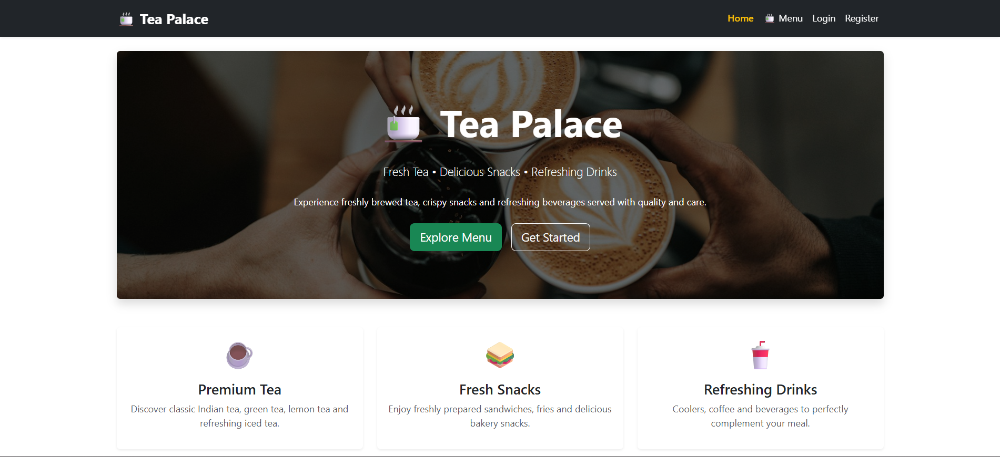
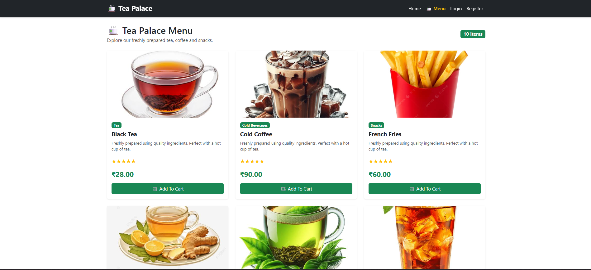
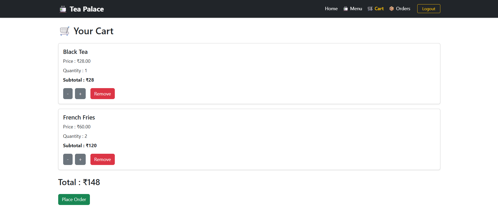
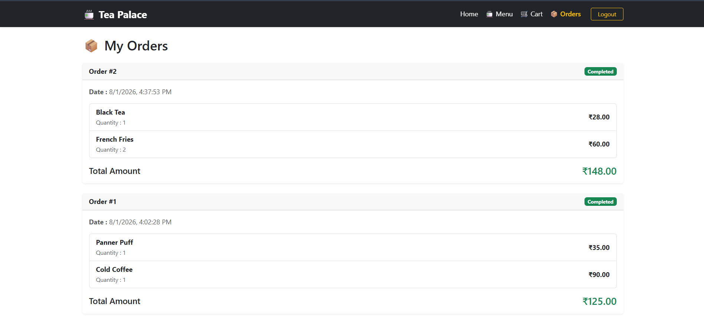
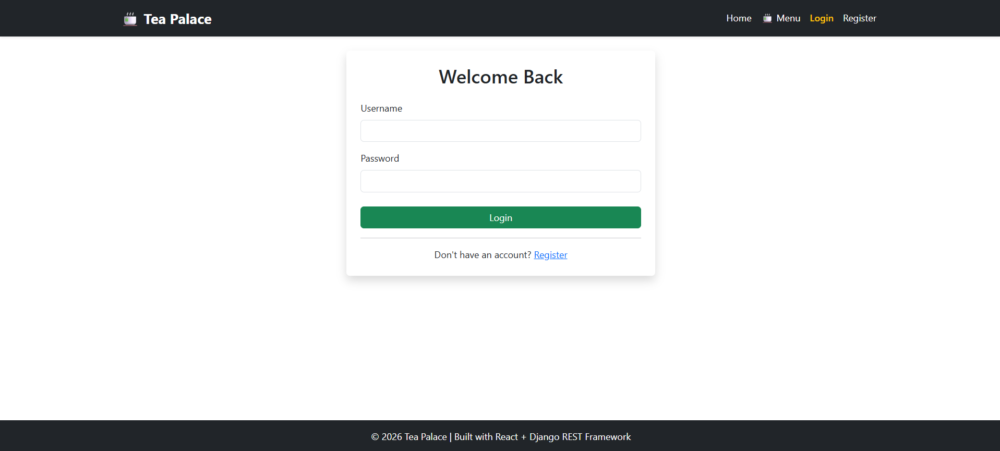
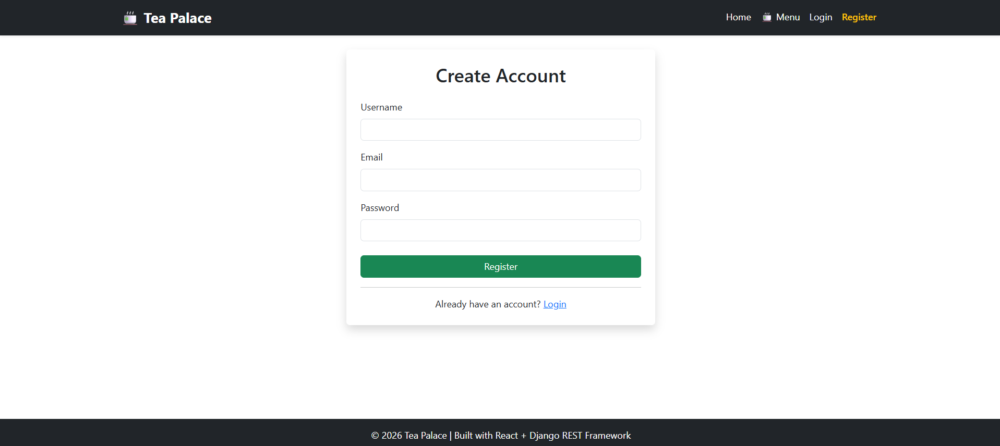

# 🍵 Tea Palace 2.0

An AI-powered full-stack tea shop web application built using **React, Django REST Framework, PostgreSQL, and Groq AI**.

Tea Palace allows users to browse tea and snack products, register and log in using JWT authentication, manage their shopping cart, place orders, and interact with an AI shopping assistant for personalized product recommendations.

## 📸 Screenshots

| Home | Products |
|---|---|
|  |  |

| Cart | Orders |
|---|---|
|  |  |

| Login | Register |
|---|---|
|  |  |

*Add AI Shopping and Floating Assistant screenshots here when available.*

## ✨ Features

### 🛒 E-commerce Features
- User registration and login
- JWT authentication
- Browse tea and snack products
- Product categories
- Add products to cart
- Update cart quantities
- Remove products from cart
- Place orders
- View order history
- Product availability validation

### 🤖 AI Shopping Assistant
- AI-powered shopping assistant using Groq
- Natural-language product search
- Product recommendations
- Budget-based product combinations
- Product details and availability information
- Add-to-cart proposals with user confirmation
- AI-powered cart summary
- AI-assisted order history
- Floating AI assistant available across the application
- Dedicated AI Shopping page

**Note:** Users can explore product recommendations without logging in. Login is required for cart operations.

## 🛠 Tech Stack

### Frontend
- React
- JavaScript
- React Router
- Axios
- Bootstrap 5
- CSS

### Backend
- Python
- Django
- Django REST Framework
- Simple JWT

### Database
- PostgreSQL

### AI Integration
- Groq API
- Groq tool calling

## 📁 Project Structure

```text
Tea-Palace/
│
├── backend/
│   ├── accounts/
│   ├── assistant/
│   ├── cart/
│   ├── orders/
│   ├── products/
│   ├── config/
│   └── manage.py
│
├── frontend/
│   ├── src/
│   │   ├── api/
│   │   ├── components/
│   │   ├── pages/
│   │   ├── App.jsx
│   │   └── main.jsx
│   ├── public/
│   └── package.json
│
├── requirements.txt
├── .gitignore
└── README.md
```

## 🚀 Installation

### 1. Clone Repository

```bash
git clone https://github.com/Azar-02/Django_fullstack_project.git

cd Django_fullstack_project
```

### 2. Backend Setup

Create and activate a virtual environment.

```bash
python -m venv .venv
```

Windows PowerShell:

```powershell
.venv\Scripts\Activate.ps1
```

Install Python dependencies from the project root:

```bash
pip install -r requirements.txt
```

Move into the backend directory:

```bash
cd backend
```

### 3. Environment Variables

Create a `.env` file inside the `backend/` directory.

```env
SECRET_KEY=your-secret-key
DEBUG=True

DB_NAME=your-database-name
DB_USER=postgres
DB_PASSWORD=your-database-password
DB_HOST=127.0.0.1
DB_PORT=5432

GROQ_API_KEY=your-groq-api-key
GROQ_MODEL=openai/gpt-oss-120b
```

Use your own local PostgreSQL database credentials and Groq API key. Never commit the `.env` file to GitHub.

### 4. Database Migration

```bash
python manage.py migrate
```

Create a superuser if required:

```bash
python manage.py createsuperuser
```

### 5. Run Django Server

```bash
python manage.py runserver
```

Backend URL:

```text
http://127.0.0.1:8000/
```

### 6. Frontend Setup

Open another terminal and navigate to the frontend directory:

```bash
cd frontend
```

Install dependencies:

```bash
npm install
```

Start the React development server:

```bash
npm run dev
```

Frontend URL:

```text
http://localhost:5173/
```

## 🔗 API Endpoints

### Authentication

| Method | Endpoint |
|---|---|
| POST | `/api/auth/register/` |
| POST | `/api/auth/login/` |
| GET | `/api/auth/profile/` |

### Products

| Method | Endpoint |
|---|---|
| GET | `/api/products/` |
| POST | `/api/products/` |
| PUT | `/api/products/{id}/` |
| DELETE | `/api/products/{id}/` |

### Cart

| Method | Endpoint |
|---|---|
| GET | `/api/cart/` |
| POST | `/api/cart/add/` |
| PATCH | `/api/cart/items/{id}/` |
| DELETE | `/api/cart/items/{id}/delete/` |

### Orders

| Method | Endpoint |
|---|---|
| POST | `/api/orders/place/` |
| GET | `/api/orders/` |

### AI Assistant

| Method | Endpoint |
|---|---|
| POST | `/api/assistant/chat/` |

The AI assistant communicates with the backend through this endpoint and uses available tools to retrieve product information, prepare cart additions, summarize carts, and retrieve order history.

## 🤖 AI Shopping Assistant – Example Prompts

Users can interact with the assistant using natural language.

Examples:

- "Recommend some popular snacks."
- "Suggest tea under ₹100."
- "Find products within my ₹200 budget."
- "Is Cold Coffee available?"
- "Add 2 Veg Puff to my cart."
- "Show my cart summary."
- "Show my recent orders."

Cart modifications require user confirmation before the operation is performed.

## 🧠 What I Learned

While building this project, I practiced:

- Django REST Framework and REST API development
- JWT authentication
- React components and routing
- Frontend and backend integration
- PostgreSQL database integration
- CRUD operations
- Shopping cart and order management
- API error handling and product availability validation
- Integrating Groq AI into a full-stack application
- AI tool calling and backend function integration
- Building an AI-powered shopping assistant

## 🔮 Future Improvements

- Product search and advanced filtering
- Online payment integration
- Order status tracking
- Product reviews and ratings
- Enhanced AI shopping recommendations

## 👨‍💻 Author

**Mohamed Azarudeen S**

- GitHub: https://github.com/Azar-02
- LinkedIn: https://www.linkedin.com/in/azarudeen-md/

---

*Tea Palace – Bringing AI-powered shopping assistance to a simple tea shop application.*